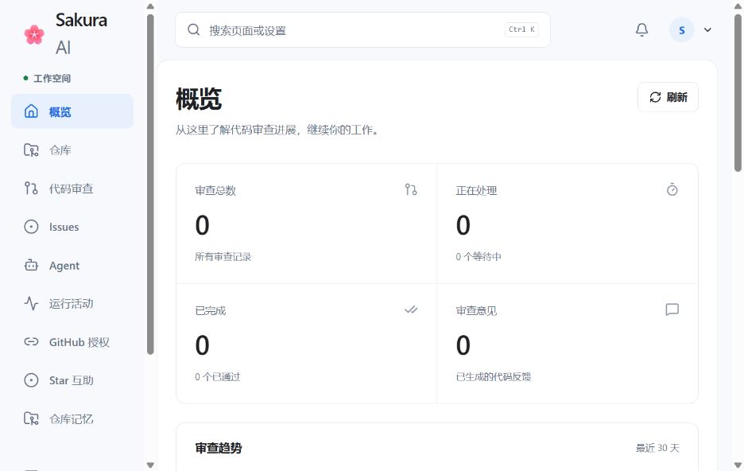
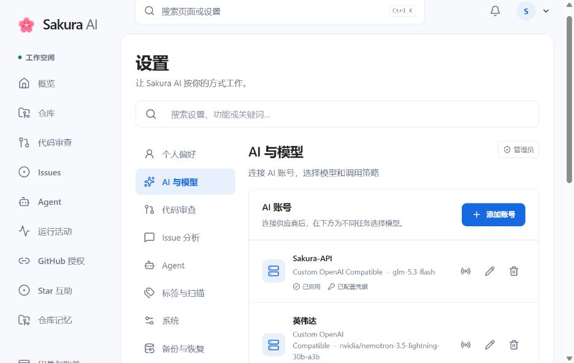

<div align="center">

# 🌸 Sakura AI

<a href="res/cover-google.png"></a>

GitHub PR 代码审查、Issue 分析与 Agent 修复

[在线体验](https://ai.firefly520.top/) · [文档站](https://sakura520222.github.io/Sakura-AI/) · [快速开始](https://sakura520222.github.io/Sakura-AI/quick-start.html)

[English](README_EN.md) | **中文**

[](https://github.com/Sakura520222/Sakura-AI/releases)
[](https://github.com/Sakura520222/Sakura-AI/actions/workflows/ci.yml)
[](https://www.python.org/)
[](LICENSE)
[](https://github.com/Sakura520222/Sakura-AI/stargazers)

</div>

Sakura AI 接入 GitHub 仓库，在 PR 和 Issue 中参与日常维护。审查时会按需查阅相关文件、搜索代码和追踪依赖；遇到需要修改的问题，可以委派给 Agent，生成 Draft PR 后继续审阅。

可以直接使用[在线服务](https://ai.firefly520.top/)，注册后领取免费体验额度，也可以部署自己的实例。

## 能做什么

- 审查 PR，给出变更摘要、分类问题和行内评论；新提交到来后继续增量审查，并通过 Check Runs 展示进度。
- 分析 Issue 的可行性与优先级，推荐标签，结合代码和截图调查问题，识别重复报告及关联 PR。
- 从 Issue 或 PR 委派 Agent 修复任务，在独立工作区中修改代码、安装依赖、运行测试并创建 Draft PR，不自动合并。
- 定期扫描仓库，将发现的代码质量与安全问题整理为报告 Issue。
- 在 WebUI 中管理仓库、模型与任务，查看 AI 对话、工具调用和用量，并按需订阅邮件、Telegram 或 Webhook 通知。

支持多家 AI 提供商与自定义兼容端点，可为审查、摘要和 Agent 分别选择模型，配置回退链。Agent 支持仓库规则、Skills、MCP 与 Hooks；生产部署使用独立的 Linux 容器沙箱执行命令。

功能细节与使用限制见[功能指南](https://sakura520222.github.io/Sakura-AI/features.html)。

## 界面预览

<table>
  <tr>
    <td width="50%" align="center" valign="top">
      <p>控制台概览</p>
      <a href="docs/images/showcase/overview.jpg"></a>
    </td>
    <td width="50%" align="center" valign="top">
      <p>Agent 工作台</p>
      <a href="docs/images/showcase/agent.jpg"></a>
    </td>
  </tr>
  <tr>
    <td width="50%" align="center" valign="top">
      <p>AI 与模型</p>
      <a href="docs/images/showcase/ai-settings.jpg"></a>
    </td>
    <td width="50%" align="center" valign="top">
      <p>审查配置</p>
      <a href="docs/images/showcase/review-settings.jpg"></a>
    </td>
  </tr>
</table>

## 快速开始

使用[在线服务](https://ai.firefly520.top/)无需准备服务器。自建完整实例需要 Linux x86_64/arm64、glibc ≥ 2.36、Docker 与作为 PID 1 运行的 systemd，推荐 Debian 12+ 或 Ubuntu 24.04+。

先阅读[部署要求](https://sakura520222.github.io/Sakura-AI/quick-start.html)，检查安装脚本内容并确认管理员权限，再执行：

```bash
curl -fsSL https://raw.githubusercontent.com/Sakura520222/Sakura-AI/main/start.sh | sudo bash -s -- --prod
```

默认部署 stable 频道，包含 Web、MySQL、Redis、Host Updater 与 Agent 沙箱。完成后按脚本提示打开 `/setup`，使用本机私有文件中的验证 Token 初始化；Token 不会写入应用日志。

其他安装方式、开发频道、升级与卸载见[部署指南](https://sakura520222.github.io/Sakura-AI/DEPLOYMENT.html)。Windows/macOS 源码开发见[开发指南](https://sakura520222.github.io/Sakura-AI/development.html)；仅运行 Web 容器不包含 Linux Agent 沙箱或 Host Updater。

## 文档与开发

| 想了解什么 | 入口 |
| --- | --- |
| 功能与使用方式 | [功能指南](https://sakura520222.github.io/Sakura-AI/features.html) · [PR 审查](https://sakura520222.github.io/Sakura-AI/PR_FEATURES_GUIDE.html) · [Issue 分析](https://sakura520222.github.io/Sakura-AI/issue-analysis.html) |
| 配置自己的实例 | [配置参考](https://sakura520222.github.io/Sakura-AI/CONFIGURATION.html) · [配置中心](https://sakura520222.github.io/Sakura-AI/configuration-center.html) |
| 运行与扩展 Agent | [运行机制](https://sakura520222.github.io/Sakura-AI/AGENT_HARNESS_RUNTIME.html) · [仓库规则与 Skills](https://sakura520222.github.io/Sakura-AI/AGENT_REPOSITORY_CONTEXT.html) · [插件](https://sakura520222.github.io/Sakura-AI/AGENT_PLUGINS.html) |
| 参与开发或接入客户端 | [开发指南](https://sakura520222.github.io/Sakura-AI/development.html) · [技术架构](https://sakura520222.github.io/Sakura-AI/ARCHITECTURE.html) · [API](https://sakura520222.github.io/Sakura-AI/api-v1-reference.html) |

后端使用 Python 3.14 与 FastAPI，前端使用 React 与 TypeScript，数据存储使用 MySQL、Redis 和 ChromaDB。完整目录可在[文档站](https://sakura520222.github.io/Sakura-AI/README.html)浏览，Markdown 原文保存在 [docs/](docs/)。

欢迎提交代码、文档和问题反馈。贡献请从 `develop` 创建特性分支，PR 目标选择 `develop`，具体流程见[贡献指南](CONTRIBUTING.md)。另有 [Android 客户端](https://github.com/Sakura520222/Sakura-AI-APP)正在开发。

## 安全与许可

安全漏洞请通过 [GitHub 私密漏洞上报](https://github.com/Sakura520222/Sakura-AI/security/advisories/new)或 <sakura520222@outlook.com> 联系维护者，不要在公开 Issue 中披露细节。参阅[安全策略](SECURITY.md)。

本项目采用 [GNU AGPLv3](LICENSE)，允许使用、修改和分发；通过网络提供修改版服务时须按许可证提供对应源代码。

## Star History

<a href="https://star-history.com/#Sakura520222/Sakura-AI&Date">
 <picture>
   <source media="(prefers-color-scheme: dark)" srcset="https://api.star-history.com/svg?repos=Sakura520222/Sakura-AI&type=Date&theme=dark" />
   <source media="(prefers-color-scheme: light)" srcset="https://api.star-history.com/svg?repos=Sakura520222/Sakura-AI&type=Date" />
   
 </picture>
</a>
