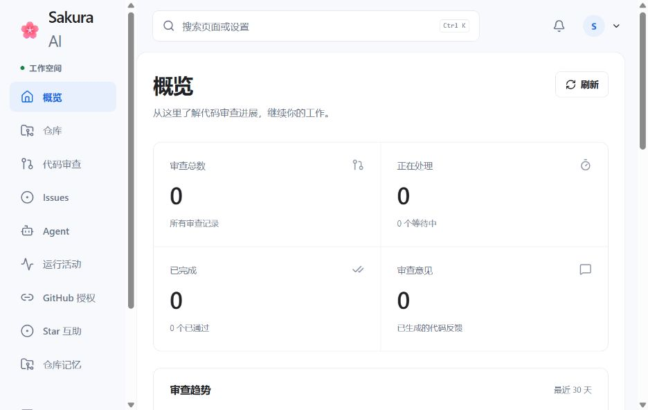
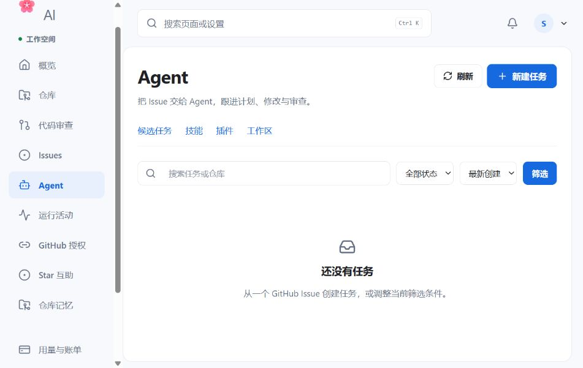
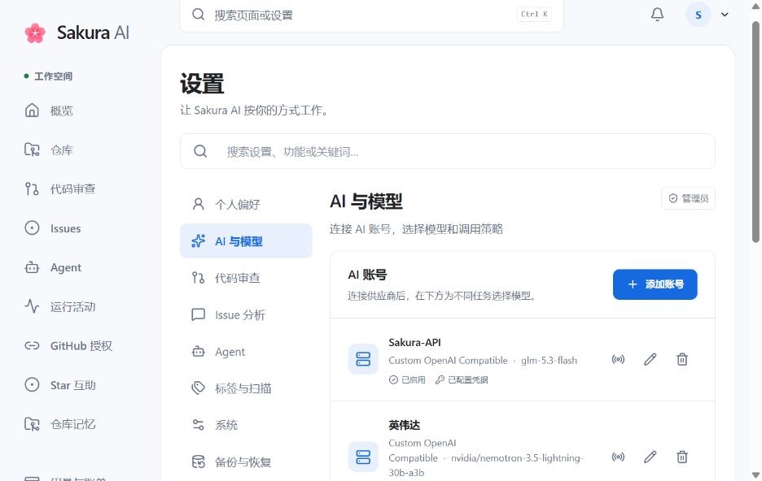
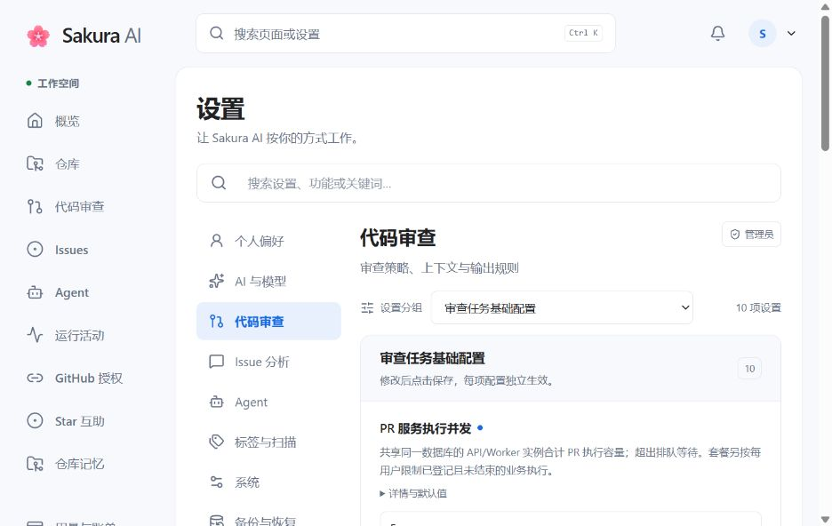

<div align="center">

# 🌸 Sakura AI

<a href="res/cover-google.png"></a>

GitHub PR reviews, Issue analysis and Agent-assisted fixes

[Try it online](https://ai.firefly520.top/) · [Documentation](https://sakura520222.github.io/Sakura-AI/) · [Get started](https://sakura520222.github.io/Sakura-AI/quick-start.html)

**English** | [中文](README.md)

[](https://github.com/Sakura520222/Sakura-AI/releases)
[](https://github.com/Sakura520222/Sakura-AI/actions/workflows/ci.yml)
[](https://www.python.org/)
[](LICENSE)
[](https://github.com/Sakura520222/Sakura-AI/stargazers)

</div>

Sakura AI connects to GitHub repositories to help with day-to-day PR and Issue maintenance. During a review, it reads related files, searches code and follows dependencies as needed. You can delegate fixes to an Agent, then review the Draft PR it creates.

Use the [hosted service](https://ai.firefly520.top/) with free trial credits after registration, or deploy your own instance.

## What it does

- Reviews PRs with change summaries, categorized findings and inline comments. New commits receive incremental reviews, with progress shown through Check Runs.
- Analyzes Issue feasibility and priority, recommends labels, investigates code and screenshots, and identifies duplicate reports and related PRs.
- Accepts Agent tasks from Issues or PRs. Each task gets an isolated workspace to edit code, install dependencies, run tests and create a Draft PR. It never auto-merges.
- Scans repositories periodically and publishes code quality and security findings as report Issues.
- Provides a WebUI for repositories, models and tasks, with AI conversations, tool calls, usage tracking and optional Email, Telegram or Webhook subscriptions.

You can use multiple AI providers or custom compatible endpoints, choose separate models for reviews, summaries and Agent tasks, and reorder fallback chains by dragging. By default, calls try the complete chain in configured order; saved changes apply to the next call. Model capabilities are selected from configured accounts and models. Agents support repository instructions, Skills, MCP and Hooks. Production deployments run commands in a separate Linux container sandbox.

See the [feature guide](https://sakura520222.github.io/Sakura-AI/features.html#english-summary) for details and limitations.

## Screenshots

<table>
  <tr>
    <td width="50%" align="center" valign="top">
      <p>Overview</p>
      <a href="docs/images/showcase/overview.jpg"></a>
    </td>
    <td width="50%" align="center" valign="top">
      <p>Agent workspace</p>
      <a href="docs/images/showcase/agent.jpg"></a>
    </td>
  </tr>
  <tr>
    <td width="50%" align="center" valign="top">
      <p>AI & models</p>
      <a href="docs/images/showcase/ai-settings.jpg"></a>
    </td>
    <td width="50%" align="center" valign="top">
      <p>Review settings</p>
      <a href="docs/images/showcase/review-settings.jpg"></a>
    </td>
  </tr>
</table>

## Quick start

The [hosted service](https://ai.firefly520.top/) needs no server setup. A full self-hosted instance requires Linux x86_64/arm64, glibc ≥ 2.36, Docker and systemd running as PID 1. Debian 12+ or Ubuntu 24.04+ is recommended.

Read the [deployment requirements](https://sakura520222.github.io/Sakura-AI/quick-start.html), inspect the installation script and confirm its administrator privileges before running:

```bash
curl -fsSL https://raw.githubusercontent.com/Sakura520222/Sakura-AI/main/start.sh | sudo bash -s -- --prod
```

This installs the stable channel with Web, MySQL, Redis, Host Updater and the Agent sandbox. When installation finishes, follow the script's instructions to open `/setup` and initialize the instance using the verification token from its private local file. The token is never written to application logs.

See the [deployment guide](https://sakura520222.github.io/Sakura-AI/DEPLOYMENT.html) for other installation options, the development channel, upgrades and uninstalling. For source development on Windows/macOS, use the [development guide](https://sakura520222.github.io/Sakura-AI/development.html#english-summary). A Web-only container does not include the Linux Agent sandbox or Host Updater.

## Documentation and development

| Topic | Links |
| --- | --- |
| Features and usage | [Feature guide](https://sakura520222.github.io/Sakura-AI/features.html#english-summary) · [PR reviews](https://sakura520222.github.io/Sakura-AI/PR_FEATURES_GUIDE.html) · [Issue analysis](https://sakura520222.github.io/Sakura-AI/issue-analysis.html#english-summary) |
| Instance configuration | [Configuration reference](https://sakura520222.github.io/Sakura-AI/CONFIGURATION.html) · [Configuration centre](https://sakura520222.github.io/Sakura-AI/configuration-center.html) |
| Running and extending Agents | [Runtime](https://sakura520222.github.io/Sakura-AI/AGENT_HARNESS_RUNTIME.html) · [Repository instructions and Skills](https://sakura520222.github.io/Sakura-AI/AGENT_REPOSITORY_CONTEXT.html) · [Plugins](https://sakura520222.github.io/Sakura-AI/AGENT_PLUGINS.html) |
| Contributing or building a client | [Development guide](https://sakura520222.github.io/Sakura-AI/development.html#english-summary) · [Architecture](https://sakura520222.github.io/Sakura-AI/ARCHITECTURE.html) · [API](https://sakura520222.github.io/Sakura-AI/api-v1-reference.html) |

The backend uses Python 3.14 and FastAPI, the frontend uses React and TypeScript, and storage uses MySQL, Redis and ChromaDB. Browse the [full documentation index](https://sakura520222.github.io/Sakura-AI/README.html) or its Markdown sources in [docs/](docs/). Most detailed guides are in Chinese; the feature, Issue and development guides include English summaries.

Code, documentation and bug reports are welcome. Create feature branches from `develop` and target PRs at `develop`; see the [contributing guide](CONTRIBUTING_EN.md). An [Android client](https://github.com/Sakura520222/Sakura-AI-APP) is also in development.

## Security and license

Report vulnerabilities through [GitHub Private Vulnerability Reporting](https://github.com/Sakura520222/Sakura-AI/security/advisories/new) or <sakura520222@outlook.com>, rather than public Issues. See the [security policy](SECURITY.md).

Sakura AI is licensed under [GNU AGPLv3](LICENSE). You may use, modify and distribute it; if you run a modified version as a network service, you must provide the corresponding source under the license.

## Star History

<a href="https://star-history.com/#Sakura520222/Sakura-AI&Date">
 <picture>
   <source media="(prefers-color-scheme: dark)" srcset="https://api.star-history.com/svg?repos=Sakura520222/Sakura-AI&type=Date&theme=dark" />
   <source media="(prefers-color-scheme: light)" srcset="https://api.star-history.com/svg?repos=Sakura520222/Sakura-AI&type=Date" />
   
 </picture>
</a>
