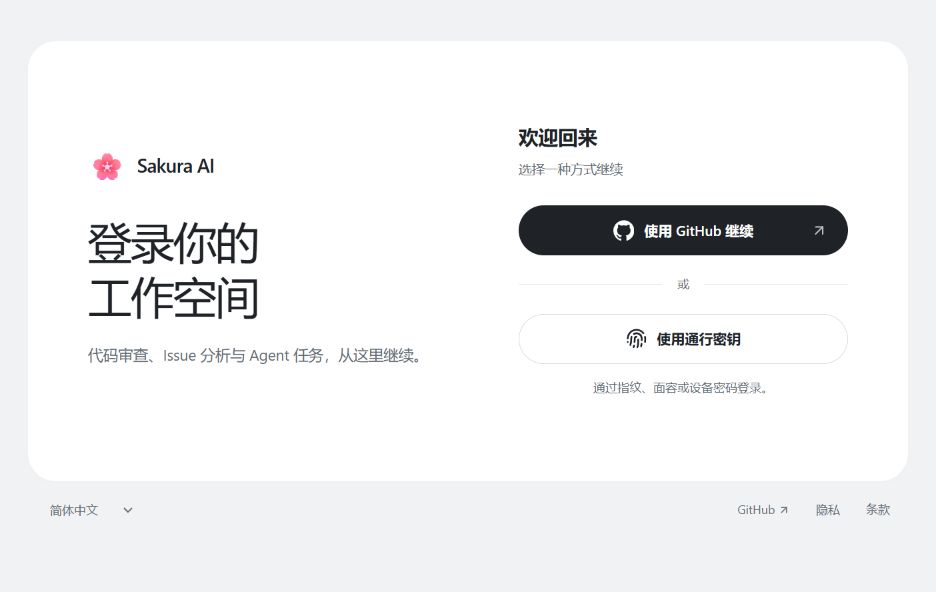
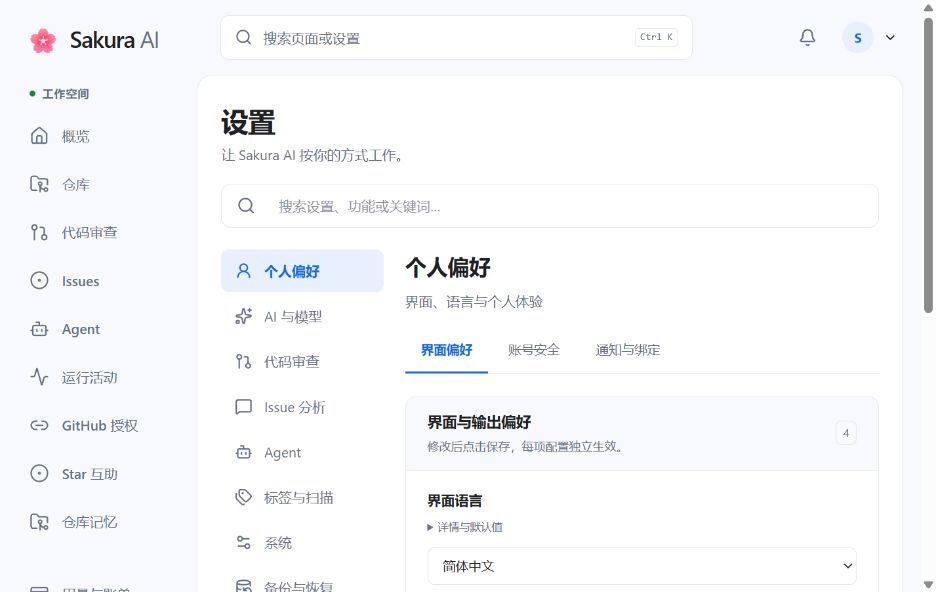

# 功能指南

## PR 审查

Sakura AI 通过 GitHub App 接收 PR 变更，按规模选择审查策略。模型可以查阅仓库文件、搜索代码和追踪依赖，再给出变更摘要、分类问题与行内评论。新提交会进入增量审查；进行中的审查不会因新提交再启动一个并行审查。

PR 页面可以展示摘要、依赖图、审查评分和 Check Runs 进度。可用评论命令手动触发审查，或用 `/revoke` 撤回 AI 评论与 Review；审查报告中的标签复选框可应用或移除标签。自动批准与行内评论可单独配置；Check Runs 本身只展示进度和结果，不作为阻塞合并的门禁。

- [PR 功能与审查生命周期](PR_FEATURES_GUIDE.md)
- [手动审查与评论命令](MANUAL_REVIEW_FEATURE.md)
- [自动批准](APPROVAL_FEATURE_SUMMARY.md)与[审查输出协议](PR_REVIEW_PROTOCOL.md)

## Issue 分析

Issue 分析会结合正文、评论和代码判断问题的可行性、优先级与处理建议，并可推荐标签、指派协作者、优化标题。调查深度随信息完整度、复杂度和风险调整；截图输入需要模型具备图片能力并启用对应配置。

关系预分析区分开放 Issue 的重复或关联，以及已关闭 Issue 的历史修复、回归、拒绝等情况。PR 语义关联会核验实际补丁，区分完整修复和部分关联，保留人工引用。候选检索、证据边界、参数和失败行为见 [Issue 分析指南](issue-analysis.md)。

## 仓库上下文与知识检索

审查和 Agent 可以按需读取文件、列出目录、搜索代码，查询分支与提交历史。配置 Web 工具后，可通过 DuckDuckGo、Tavily 或 URL 抓取补充外部资料；是否可用仍受任务网络策略限制。

仓库级 RAG 用向量语义检索查找项目文档；PR 代码索引按语法分块，为代码定位提供检索上下文。它们需要配置对应的嵌入模型与索引。相关开关和参数见[配置参考](CONFIGURATION.md)，上下文预算与压缩见[模型上下文](MODEL_CONTEXT_FEATURE.md)。

`.sakura/` 可保存项目知识与反思资料。[项目记忆指南](SAKURA_MEMORY_GUIDE.md)包含旧版机制说明，涉及具体开关和行为时请同时核对当前配置。

## 仓库扫描

扫描按配置周期检查仓库的代码质量与安全问题。管理员可在配置中心调整间隔、冷却时间、Token 预算、并发以及 `strategy.scan` 的提示词 focus。

扫描期间的模型对话与工具调用可在 WebUI 活动页查看。完成后通过 GitHub 报告 Issue 和 WebUI 展示总结、趋势对比、严重性与类别分布、热点文件及明细；被新报告取代的旧报告 Issue 会自动关闭。输出使用 `<SAKURA_SCAN>` 协议，并在格式错误时尝试修复或安全降级。

配置入口见[配置参考的标签与扫描部分](CONFIGURATION.md)，扫描通知的管理员权限见[通知中心](NOTIFICATION_CENTER.md)。

## Agent 修复任务

超级管理员可以手动创建任务，用户也可从 Issue 或 PR 评论 `/agent` 委派。每个任务使用独立 Git worktree，主 Agent 修改代码，并可委派只读子 Agent 调查。任务可以安装依赖、运行验证、创建 Draft PR，再根据审查和人工反馈继续迭代，不自动合并。

生产环境的命令执行由独立 sandboxd 管理一次性非 root 容器。网络出口、依赖安装、仓库挂载和恢复都有各自的边界；仅运行 Web 镜像不等于已经启用 Agent 沙箱。本地 `local` 后端仅用于源码开发，不提供同等 OS 隔离。

依赖安装遇到瞬时网络故障时，默认最多尝试 3 次，按 2、4 秒退避；永久错误不重试。最终失败保留脱敏诊断，供 Agent 修复安装或继续静态分析，并报告不能运行的测试。管理员可通过实时视图补充指导，也可取消任务。

- [部署要求、完成与恢复、并发及安全边界](AGENT_HARNESS_RUNTIME.md)
- [仓库规则、Skills 与上下文](AGENT_REPOSITORY_CONTEXT.md)
- [MCP、Hooks 与插件管理](AGENT_PLUGINS.md)
- [网络策略与依赖出口配置](CONFIGURATION.md#agent-专家团队)

## 仓库互助

仓库互助是可选的点星与展示功能。成员授权后选择公开仓库展示，系统可生成仓库摘要，并按随机间隔代表成员为其他参与仓库点星。自动与手动点星共用幂等逻辑，受每用户、每仓库的每日上限约束。

用户可加入、退出或暂停；管理员可管理成员、封禁违规成员或禁用仓库。WebUI 提供成员、仓库、当日用量与审计信息，记录 star、unstar、skip 和 fail 结果。

授权使用 GitHub App user-to-server 流程，GitHub 账号必须与当前登录用户一致；Token 加密保存，不写入日志。接入和 Starring 权限要求见[部署指南](DEPLOYMENT.md)。普通用户也可在 GitHub App 授权中心查看自己可访问的安装与仓库，并跳转 GitHub 调整授权范围。

## WebUI、账号与实例管理

WebUI 使用 React 与 TypeScript，提供仓库、审查、Agent、活动观测、账务和设置入口。实时视图记录会话、线程、提供商尝试、工具与压缩过程；模型调用可追踪 Token 和预估成本。敏感活动内容加密存储，解密操作保留审计。

配置中心按个人、AI、PR、Issue、Agent、标签与扫描、系统和备份组织设置。当前界面逐字段显式保存，失败或版本冲突保留草稿；重置通过移除覆盖恢复继承值。凭据、导入和危险操作需要确认。数据库与 Redis 连接仍由部署配置管理，导入备份不会覆盖它们。详见[配置中心](configuration-center.md)和 [WebUI 说明](webui-2.md)。

AI 账号可分别绑定审查、摘要、Agent 等角色，支持多账号、回退链和模型能力覆盖。普通设置可按用户配置、全局配置与 Settings 默认值逐级回退；应用时区等重启项按页面提示重启。配置位置和生效方式以[配置参考](CONFIGURATION.md)为准。

GitHub OAuth 与 Passkey 使用同一内部用户身份，Telegram 只用于可选通知，不决定登录或权限。[安全与 MFA 指南](SECURITY_MFA_GUIDE.md)说明 TOTP、恢复码、Passkey 与强制 MFA。

### 通知与账务

[通知中心](NOTIFICATION_CENTER.md)汇集 PR、Issue、扫描、Agent、公告与账户事件，支持站内历史和未读状态，以及邮件、Telegram、Webhook 订阅。外部业务通知需显式订阅，敏感账户事件只发往经验证的私人目标；扫描和 Agent 通知还受资源权限限制。超级管理员可发布公告，并查看发送轮次与投递结果。

自建实例可配置配额、套餐、兑换码、Credits 钱包与支付；正式收费默认关闭。实际 AI Usage 定价、购买、退款和旧权益迁移有独立契约，启用前请阅读 [Billing 2.0](billing-2.md)与[配额指南](QUOTA_SYSTEM_GUIDE.md)，不要把展示的预估成本当作最终账单。

### 其他界面

<figure>
  
  <figcaption>登录：GitHub OAuth 与通行密钥。</figcaption>
</figure>

<figure>
  
  <figcaption>个人偏好：语言、外观与账号设置。</figcaption>
</figure>

## English summary

Sakura AI connects to GitHub through a GitHub App. It reviews PRs, analyzes Issues, scans repositories and accepts Agent fix tasks. Reviews can read related code, publish summaries and inline findings, and continue after new commits. `/revoke` withdraws AI comments and reviews; label checkboxes in reports apply or remove labels. Check Runs display progress and results rather than blocking merges.

[Issue analysis](issue-analysis.md#english-summary) covers screenshots, concise comments, duplicate detection and verified PR links. RAG and code indexing provide repository context when configured. Scheduled scans publish report Issues and expose their conversations in the WebUI.

Agents work in isolated Git worktrees and can install dependencies, run tests and create Draft PRs without auto-merging. Production command execution needs the Linux sandbox, not just the Web container. Read the [runtime guide](AGENT_HARNESS_RUNTIME.md#english-summary), [repository context guide](AGENT_REPOSITORY_CONTEXT.md#english-summary) and [plugin guide](AGENT_PLUGINS.md#english-summary) for capabilities and restrictions.

Repository Aid is an optional, authorized repository showcase and mutual-star feature with daily limits, member controls and audit records. GitHub App authorization only exposes installations and repositories available to the signed-in GitHub user.

The WebUI groups repositories, reviews, Agent tasks, activity, billing and settings. Configuration fields require explicit saves; resets remove overrides, and conflicts retain drafts. Database and Redis connections remain deployment-owned. [Notifications](NOTIFICATION_CENTER.md) require subscriptions for external business delivery and preserve resource permissions. [Billing](billing-2.md) is disabled for charging by default; actual metered usage and the billing contract determine charges, not token cost estimates.
